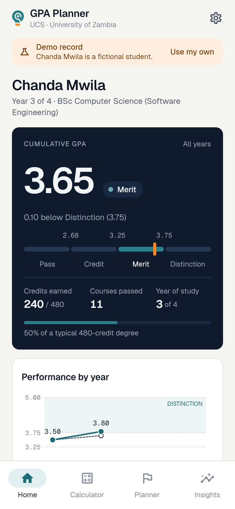
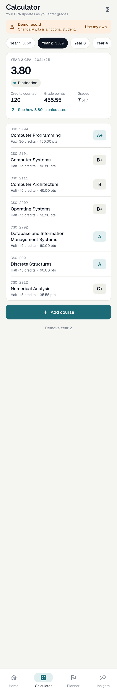
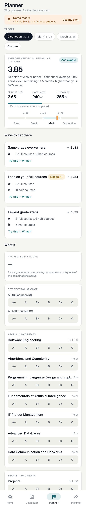
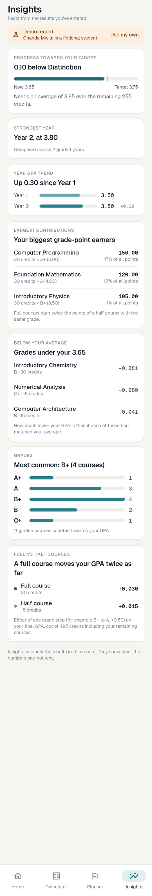

# UCS GPA Planner

An Android app from the University of Zambia Computer Science Society (UCS) for Computer Science
students. It calculates your GPA the way UNZA does, shows your degree class, and works out the
grades you need for the class you want.

<p>




</p>

## What it does

- **Home:** cumulative GPA, class and distance to the next class, credits earned out of 480, and
  the trend for each year and the cumulative GPA.
- **Calculator:** each year's courses with their weight (full 30 credits, half 15, or a custom
  value), grade and grade points. The GPA updates as you edit. "See how it's calculated" shows
  every step.
- **Planner:** pick Distinction, Merit, Credit or a custom GPA. It shows the average you need in
  your remaining courses, whether that's possible, realistic grade combinations, and a what-if mode
  ("A in my full courses, B+ in my half courses").
- **Insights:** strongest year, trend, biggest grade-point contributions, grades below your average,
  grade distribution, and how much more a full course moves your GPA than a half course. Only facts
  from your entered results.
- **Settings:** profile, demo and own record, light or dark theme, backup export and restore,
  privacy, and the full methodology with sources.

The app opens with a demo record for **Chanda Mwila, a fictional student**, so anyone can explore
it before entering their own results. The demo is clearly labelled and kept separate from your own
record.

## GPA rules

Based on UNZA's Quality Assurance Directorate guidelines, *Credit Accumulation, Grade Point Average
and Degree Classification*. The rules that are not stated in that document are marked in the app
and in [docs/GPA_METHODOLOGY.md](docs/GPA_METHODOLOGY.md), together with the open questions for UCS
to confirm.

## Build

Requirements: JDK 17+ and the Android SDK (easiest through Android Studio).

```bash
./gradlew :app:assembleDebug          # app/build/outputs/apk/debug/app-debug.apk
./gradlew :core:test :data:test       # engine and data tests
./gradlew -p tools/desktop-preview :ui-desktop:test   # UI tests + screenshots, no Android SDK needed
```

Or open the folder in Android Studio and press Run.

**Without Android Studio:** push the repository to GitHub. The included workflow
(`.github/workflows/android.yml`) runs the tests, builds the APKs and attaches them to the run
under *Artifacts*.

### Release signing

Release builds are signed with the debug key unless a release key is provided. Locally, set the
environment variables `UCS_KEYSTORE_FILE` (path to the .jks), `UCS_KEYSTORE_PASSWORD`,
`UCS_KEY_ALIAS` and `UCS_KEY_PASSWORD`. On GitHub, add the repository secrets
`UCS_KEYSTORE_BASE64` (the .jks file, base64-encoded), `UCS_KEYSTORE_PASSWORD`, `UCS_KEY_ALIAS`
and `UCS_KEY_PASSWORD`. Create one UCS keystore, keep it safe, and use it for every release:
Android only accepts updates signed with the same key. Before publishing, also choose the final
`applicationId` in `app/build.gradle.kts` (currently `ucs.gpaplanner`), since it cannot change
afterwards.

## Project layout

```
core/                 GPA engine and academic rules (pure Kotlin, unit tested)
data/                 storage, backups, demo data, app state (pure Kotlin, unit tested)
app/                  Android app; app/src/main/kotlin/ucs/gpa/ui holds all screens
tools/desktop-preview Builds the same UI for the JVM to render screenshots and run UI tests
docs/                 architecture, methodology, testing, review of the first version
```

See [docs/ARCHITECTURE.md](docs/ARCHITECTURE.md) and [docs/TESTING.md](docs/TESTING.md).

## Privacy

Results are stored only on the phone, in app-private storage. There are no accounts, no network
access and no permissions. Backups are files the student saves where they choose.

## Credits

Logo: UCS. Typeface: Geist and Geist Mono by Vercel, SIL Open Font License 1.1
([docs/FONT_LICENSE_OFL.txt](docs/FONT_LICENSE_OFL.txt)).

An unofficial planning tool. Official results are on the UNZA Student Information System.
